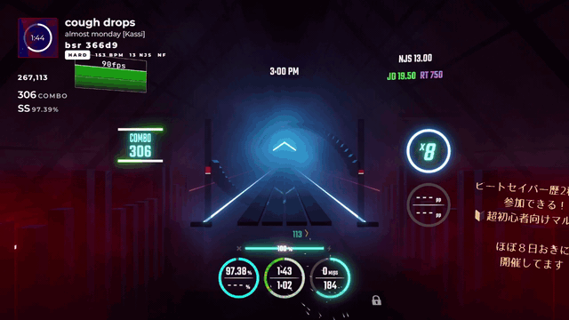

# Beat115Icon

Beat Saber 向け 115点カスタムアイコン表示MODです。  
パーフェクトカット（115点）を達成した際に、「115」という数字の代わりにカスタムPNGアイコンをランダム表示します。  
**バニラ（Beat Saber標準）および NalulunaCutScore の両方に完全対応**しています。

A custom score 115 icon replacement mod for Beat Saber.  
Replaces the standard "115" score text with custom PNG icons upon scoring a perfect cut (115).  
**Fully compatible with both Vanilla (standard Beat Saber) and NalulunaCutScore.**

▶ [音声付き動画 / Full Video with Audio (MP4)](docs/demo.mp4)

---

> [!WARNING]
> ### 免責事項 / Disclaimer
> 
> 本MODは wacky が個人的に楽しむために作成・カスタマイズしているものです。  
> そのため、他のPC環境や将来のBeat Saberバージョンでの動作は保証できません。  
> 導入およびご利用はすべて自己責任にてお願いいたします。
> 
> This mod is created and maintained by wacky purely for personal enjoyment.  
> As such, proper operation in other environments or future Beat Saber versions is not guaranteed.  
> Please use this mod entirely at your own risk.

---

## 🌺 主な特徴 / Features

1. **バニラ＆NalulunaCutScore ハイブリッド両対応 / Vanilla & NalulunaCutScore Dual Support**
   - **バニラ環境**: NalulunaCutScoreが導入されていなくても、Beat Saber標準のスコアポップアップ（`FlyingScoreEffect`）で115点が出た瞬間にアイコンを表示。フェード曲線にも完全追従。
   - **NalulunaCutScore併用時**: NalulunaCutScoreのスコア表示も自動検出し、同様にアイコン化。
2. **数字を消してクリアな表示 / Clean Display without Overlapping Numbers**
   - 115点達成時、数字テキストを完全に非表示にし、アイコンのみを綺麗に描画します。
3. **ゼロ遅延のランダム画像抽選 / Zero-lag Random Sprite Selection**
   - `UserData/Beat115Icon/` フォルダ内のすべてのPNG画像をゲーム起動時にメモリへ先読みキャッシュ。ノーツカット時のカクつき（フレームドロップ）が一切ありません。
4. **好きな画像を追加可能 / Customizable Images**
   - お好みの透過PNG（256×256推奨）を `UserData/Beat115Icon/` に入れるだけで、自動的に抽選プールに追加されます。
   - サンプルとしてハイビスカスアイコン3種（赤・ピンク・黄）を同梱しています。
5. **ゲーム内設定UI（BSML対応） / In-Game Settings UI (BSML)**
   - **MOD SETTINGS > Beat115Icon** および **選曲画面左パネル（GameplaySetup）> Beat115Icon** の両方から、アイコンサイズ（NalulunaCutScore用 / バニラ用）・上下オフセット・115点時の数字非表示・下線色変更をリアルタイムに調整・リセットできます。

---

## 🔧 前提MOD / Prerequisites
- [BSIPA](https://github.com/beat-saber-modding-group/BeatSaber-IPA-Reloaded) (4.3.0+)
- [BeatSaberMarkupLanguage (BSML)](https://github.com/monkeymanboy/BeatSaberMarkupLanguage) (1.12.0+)
- ※NalulunaCutScoreは任意（無くてもバニラ単体で動作します / Optional）

---

## 📦 インストール方法 / Installation
1. [Releases](../../releases) から最新の ZIP ファイルをダウンロードし、Beat Saber のインストールフォルダにそのまま解凍してください（`Plugins/Beat115Icon.dll` と `UserData/Beat115Icon/` が配置されます）。
2. お好みの透過PNG画像を `UserData/Beat115Icon/` フォルダへ追加・入れ替えしてお楽しみください。
